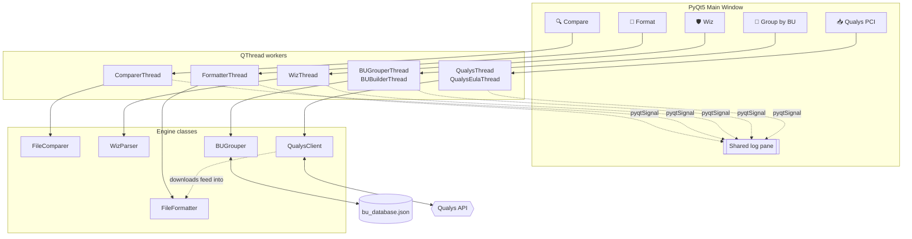
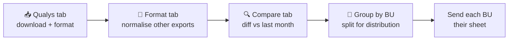

# Vuln Report Formatter

> A desktop toolkit for vulnerability-management teams: pull reports from Qualys, normalise messy scanner exports, diff two scans, flatten Wiz JSON, and split findings by business unit — all from one PyQt5 window.

<p align="center">
  
  
  
  
</p>

---

## Table of contents

- [What it does](#what-it-does)
- [Architecture](#architecture)
- [Installation](#installation)
- [Quick start](#quick-start)
- [The five tabs](#the-five-tabs)
  - [1. Format File](#1--format-file)
  - [2. Compare Files](#2--compare-files)
  - [3. Wiz](#3--wiz)
  - [4. Group by BU](#4--group-by-bu)
  - [5. Qualys PCI](#5--qualys-pci)
- [Format detection rules](#format-detection-rules)
- [The BU database](#the-bu-database)
- [Credential handling](#credential-handling)
- [Typical workflow](#typical-workflow)
- [Troubleshooting](#troubleshooting)
- [Project layout](#project-layout)
- [Extending the tool](#extending-the-tool)

---

## What it does

Security scanners each export their own flavour of CSV: junk preamble rows, a second header buried halfway down the file, forty columns where five matter, inconsistent delimiters and encodings. This tool absorbs that mess and produces clean, analyst-ready Excel workbooks.

| | Capability |
|---|---|
| 📁 | **Normalise** scanner exports — auto-detect the format, promote the real header row, hide the noise columns |
| 🔍 | **Diff two scans** on a composite asset + vulnerability key to see what was fixed, what appeared, what persists |
| 🛡️ | **Flatten Wiz JSON** — extract `SECURITY_TOOL_FINDING` entities out of nested `issuesV2` GraphQL responses |
| 🏢 | **Split by business unit** using a local hostname → BU lookup database |
| 📥 | **Pull from Qualys** — list, filter and download reports over the API, then format them in one pass |

Two design decisions run through the whole tool:

- **Columns are hidden, never deleted.** Every output workbook keeps 100% of the source data; irrelevant columns are just collapsed in Excel. Nothing is lost, and an analyst can unhide a column when they need it.
- **Everything is logged.** Each operation streams a running commentary into the dark log pane at the bottom of the window — which encoding worked, which header row was found, which columns were missing, how many rows matched.

---

## Architecture



The separation is deliberate and consistent:

- **Engine classes** are pure Python — no Qt imports, no UI assumptions. Each takes a `log_callback` and returns `(success, result)`. They can be imported and driven from a script or a test without ever creating a `QApplication`.
- **Worker threads** are thin `QThread` wrappers that emit `progress`, `log_message` and `finished_signal`. They exist purely to keep the UI responsive during long I/O.
- **The window** wires widgets to workers and renders signals. No business logic lives there, with one exception: `_refresh_bu_db_status()`, which reads the BU database metadata to paint the status banner.

---

## Installation

**Requirements:** Python 3.8 or newer.

```bash
git clone <your-repo-url>
cd vuln-report-formatter

python -m venv .venv
source .venv/bin/activate          # Windows: .venv\Scripts\activate

pip install PyQt5 pandas openpyxl xlrd
```

| Package | Used for |
|---|---|
| `PyQt5` | The entire GUI |
| `pandas` | All CSV/Excel reading, filtering and reshaping |
| `openpyxl` | Writing `.xlsx` and hiding columns post-write |
| `xlrd` | Legacy `.xls` reading (only if you handle old files) |

The Qualys client deliberately uses **nothing but the standard library** (`urllib`, `ssl`, `base64`, `hmac`, `hashlib`, `xml.etree`) — no `requests`, no `cryptography`. That keeps the dependency surface small enough to drop the script onto a locked-down corporate workstation.

---

## Quick start

```bash
python VM_File_Formatter.py
```

The Format, Compare, Wiz and Group by BU tabs work immediately. **The Qualys tab needs the credential vault set up first** — see [Credential handling](#credential-handling). In short:

```bash
# 1. Point at your Qualys pod and API account
export QUALYS_API_URL="https://qualysapi.qualys.com"   # your pod — see below
export QUALYS_API_USER="<your api username>"

# 2. Choose a vault secret (same value on every machine)
export VAULT_SECRET="<a long random passphrase>"

# 3. Encrypt the Qualys API password
python VM_File_Formatter.py --encrypt-qualys-password
```

Step 3 prompts twice with hidden input and prints a `_QUALYS_PWD_TOKEN = "..."` line to paste into the script. The same command rotates the password later.

Until all four are in place the tab shows exactly what is still missing, both in the banner and when you press a button.

---

## The five tabs

### 1. 📁 Format File

Takes one messy export and produces a clean workbook.

**Loading is defensive.** For CSV input it tries the cartesian product of five encodings (`utf-8`, `utf-8-sig`, `latin-1`, `cp1252`, `iso-8859-1`) against four delimiters (`,` `;` tab `|`), keeping whichever combination yields the most columns and short-circuiting as soon as it sees five or more. If that still fails, it falls back to a line-by-line reader that samples the first 20 lines, counts delimiter frequency to pick the most likely separator, reads every row with `csv.reader`, and pads short rows so the DataFrame is rectangular.

**Then it identifies the format** (see [Format detection rules](#format-detection-rules)), marks the non-essential columns, converts to `.xlsx`, and uses `openpyxl` to set `hidden = True` on each of those columns.

The trickiest case it handles is the Qualys scan export where the real header row sits in the middle of the file: the loader scans column A looking for the string `IP`, and on the **second** occurrence promotes that row to the header and discards everything above it.

---

### 2. 🔍 Compare Files

Diffs two scans to answer "what changed?"

It builds a composite key per row:

```
UniqueID = <asset identifier> | <vulnerability title>
```

The asset identifier is resolved by probing for a column named any of `AssetName`, `Asset Name`, `Hostname`, `Host`, and falling back to `DNS` / `FQDN` / `DNS Name`. The title column probes `Title` and `Vulnerability Title`. All matching is case-insensitive and whitespace-tolerant, so two exports that disagree on capitalisation still line up.

Output is a four-sheet workbook:

| Sheet | Meaning |
|---|---|
| `Matching (Both Files)` | Findings present in both scans — still open |
| `Only in File 1` | Present in the baseline, gone from the newer scan — likely remediated |
| `Only in File 2` | New in the second scan |
| `Summary` | Row counts, unique key counts, which columns were used as keys |

The helper `UniqueID` column is dropped from the output sheets; it exists only during the set arithmetic.

---

### 3. 🛡️ Wiz

Walks a Wiz GraphQL `issuesV2` response and pulls out every `SECURITY_TOOL_FINDING` entity, flattening a deeply nested structure into a flat CSV:

| Column | Source |
|---|---|
| `Rule` | `sourceRules[0].name` |
| `Asset` | `entity.name` |
| `Account Name` | `cloudAccounts[0].name` |
| `Subscription ID` | `cloudAccounts[0].externalId` |
| `CVE` | the finding entity's `name` |
| `Description` | `properties.description`, falling back to `properties.CVEDescription` |

Every field access is **null-safe by construction**. The API returns explicit `null` — not a missing key — for `sourceRules`, `cloudAccounts`, `entity`, `evidenceQueryResults` and `properties`, which means `.get(key, default)` would happily hand back `None` and crash the next access. The parser uses `issue.get("sourceRules") or [{}]` throughout, catching the missing-key and the null case in a single expression.

On completion it reports total findings plus unique CVE, asset and rule counts.

---

### 4. 🏢 Group by BU

Splits a formatted findings file into one Excel sheet per business unit.

**Rebuild the database.** Point it at a master inventory workbook with one sheet per BU and hostnames in column A (it looks for a `DNS` header, else uses the first column). It flattens every sheet into a single `hostname → BU` map, lower-casing hostnames for case-insensitive matching, and writes `bu_database.json` beside the script.

Duplicate hostnames across BUs are **detected, logged and reported** rather than silently resolved — first occurrence wins, and the count surfaces in the status banner so somebody can go fix the master file.

**Group a file.** It resolves the asset column (`DNS`, `Asset Name`, `AssetName` or `Resource Name`), looks each row up in the database, and writes one sheet per BU plus a `Summary` sheet with per-BU counts and a `TOTAL` row. Anything that doesn't resolve lands in a sheet named `_Unmapped` — which doubles as a coverage report for your inventory.

Sheet names are truncated to Excel's 31-character limit. The column-hiding rules from the Format tab are re-applied to every BU sheet, so grouped output stays as readable as formatted output.

A coloured banner at the top of the tab always shows whether a database exists, how many assets and BUs it holds, which master file produced it, when, and whether duplicates were found.

---

### 5. 📥 Qualys PCI

Downloads reports straight from the Qualys API and optionally formats them in the same run.

The List Reports endpoint can't filter server-side by title or launch date, so the client pulls the full list (optionally narrowed by `state`) and filters client-side on:

- **title contains** a keyword — defaults to `PCI`, editable
- **launch month** — current month only, toggleable
- **output format** — CSV only, so the formatter has something it can parse

Each match is fetched and written to the chosen folder with a sanitised `<title>_<id>.<ext>` filename. If "Apply formatting rules after download" is ticked, every downloaded CSV/XLSX is immediately run through `FileFormatter` and saved as `*_formatted.xlsx`.

**First-login activation is handled.** API-only Qualys accounts have never accepted the EULA through the GUI, so their first API call fails with a registration error. `is_registration_error()` sniffs for that family of responses (`2003`, `registration`, `eula`, `access denied`, `not activated`, `pending activation`, `first login`), and the thread automatically calls `/msp/acceptEULA.php` and retries once. There's also a manual **Accept EULA / Activate Account** button.

Error handling distinguishes three failure modes that would otherwise look identical: an HTTP error (body excerpt included in the message), a connection error, and a `200 OK` whose body is actually a `SIMPLE_RETURN` XML error document rather than the report file.

---

## Format detection rules

All detection lives in one place: the module-level `detect_columns_to_keep(columns, first_column_override=None)`, which returns a `(rule_name, columns_to_keep)` tuple. Both the Format tab and the Group by BU tab call it, so a rule added once applies everywhere.

Detection keys off the first column name — and occasionally the second — then selects which columns stay visible.

| Detected by | Source | Columns kept visible |
|---|---|---|
| `ID` + `WizURL` | Wiz export | `Name`, `AssetName`, `AssetRegion`, `LocationPath`, `SubscriptionName`, `Description`, `Remediation`, `FixedVersion` |
| `ID` alone | Generic scanner | `DNS`, `IP`, `Vulnerability Title`, `RESULTS`, `SOLUTION` |
| `Created At` | Cloud posture export | `Title`, `Resource Name`, `Subscription Name`, `Subscription ID` |
| `QID` | Qualys | `Title`, `Asset Name`, `Asset IPV4`, `Results`, `Solution` |
| First line is `"Asset Vuln Datalist Report"` | Qualys datalist | `Title`, `Asset Name`, `Asset IPV4`, `Results`, `Solution` — first 3 preamble rows skipped |
| First column is `IP` | Qualys scan report | `IP`, `DNS`, `Title`, `CVE ID`, `OS`, `Results`, `Solution` |
| `Title` and `Asset Name` both present | already-formatted datalist | `Title`, `Asset Name`, `Asset IPV4`, `Results`, `Solution` |
| Nothing matches | — | All columns stay visible, logged as unmatched |

The last row is a column-name fallback rather than a first-column match, so it catches files that have already been through the formatter once. It is tried only after every first-column rule has missed.

Columns listed in a rule but absent from the file are logged as missing rather than raising — a vendor dropping a column changes the log line, not the exit code.

**The buried header row.** When no rule matches, the Format tab falls back to `_find_and_apply_ip_header_row()`, which scans column A for the string `IP` and, on the **second** occurrence, promotes that row to the header and discards everything above it. Detection is then re-run against the restructured frame, which normally lands on the `IP` rule above.

**Caller differences.** `FileFormatter` passes `first_column_override` — either the `__asset_vuln_datalist__` sentinel or the header value it recovered from the first data row — because its DataFrame columns may still be integers at that point. `BUGrouper` passes its columns directly, minus the `Business Unit` column it appends, so that column can never be mistaken for a source column.

---

## The BU database

```jsonc
{
  "_meta": {
    "generated_at": "2026-11-10T08:30:00+00:00",
    "source_file": "master_inventory.xlsx",
    "total_assets": 4821,
    "business_units": ["Finance", "Platform", "Retail"],
    "assets_per_bu": { "Finance": 1204, "Platform": 2310, "Retail": 1307 },
    "duplicates_found": 2
  },
  "assets": {
    "host01.corp.example.com": "Finance",
    "host02.corp.example.com": "Platform"
  }
}
```

It lives next to the script at `SCRIPT_DIR/bu_database.json`, resolved via `os.path.abspath(__file__)` so it's found regardless of the working directory the app was launched from.

The flat `hostname → BU` shape makes lookup O(1) per row, and keeping the `_meta` block separate means the UI can read the status banner without parsing thousands of asset entries.

---

## Credential handling

**Nothing organisation-specific ships in this repository.** The pod URL, the API username, the vault secret and the password token are all blank by default, so the script can be published or shared as-is. The Qualys tab stays inert until all four are supplied, and `qualys_config_problems()` drives a banner that names precisely which ones are still missing.

### Setting it up

**1. Point at your Qualys pod and account.**

```bash
export QUALYS_API_URL="https://qualysapi.qualys.com"
export QUALYS_API_USER="<your api username>"
```

Qualys has one base URL per platform ("pod"), and yours depends on which one your subscription lives on — check **Help → About** in the Qualys UI. Common ones:

| Region | Base URL |
|---|---|
| US | `https://qualysapi.qualys.com`, `https://qualysapi.qg2.apps.qualys.com` |
| EU | `https://qualysapi.qualys.eu`, `https://qualysapi.qg2.apps.qualys.eu` |
| IN | `https://qualysapi.qg1.apps.qualys.in` |

That list is not exhaustive and Qualys may add pods. There are in-file fallbacks (`_QUALYS_API_URL_FALLBACK`, `_QUALYS_API_USER_FALLBACK`) for deployments where environment variables aren't workable — filling them in writes your pod and username into the source, so don't commit them to a shared repo.

**2. Choose a vault secret.** It is read from the `VAULT_SECRET` environment variable:

```bash
export VAULT_SECRET="<a long random passphrase>"     # macOS / Linux
setx    VAULT_SECRET "<a long random passphrase>"    # Windows
```

There is also an in-file fallback, `_VAULT_SECRET_FALLBACK`, left deliberately empty. Filling it in puts the secret back into the source and gives up most of the benefit — use it only if an environment variable genuinely isn't workable in your deployment.

**3. Encrypt the password:**

```bash
python VM_File_Formatter.py --encrypt-qualys-password
```

It refuses to run if no secret is configured, prompts twice with hidden input, and prints the token to paste into `_QUALYS_PWD_TOKEN`.

The **same secret must be set on every machine** that decrypts the same token. Changing the secret invalidates every existing token, so re-run the command and paste a fresh one.

### How the scheme works

Stdlib-only, no `cryptography` dependency: PBKDF2-HMAC-SHA256 (200,000 iterations) derives a 32-byte key from the vault secret plus a random 16-byte salt, an HMAC-SHA256 counter-mode keystream is expanded to the plaintext length, and the ciphertext is XORed and base64-encoded with the salt prefixed.

The plaintext is handled carefully at runtime. `QualysClient` receives a **callable**, not a string, so the password is only materialised inside `_send()` at the moment the `Authorization` header is built, and is `del`-ed immediately after. It is never stored on the instance, never logged, never written to disk.

Misconfiguration fails loudly rather than silently. `VaultNotConfigured` is raised — and surfaced in the log pane with a 🔑 prefix — when no secret is set, when no token is stored, or when the secret doesn't match the one that produced the token. A wrong secret never yields a plausible-looking garbage password that produces a confusing 401 later.

> ### ⚠️ Know what this protects against
>
> With the secret in the environment, the repository on its own contains nothing usable: a token without its secret is inert. That is the point of keeping it out of the file.
>
> It is still **obfuscation, not key management**. The secret sits in the environment of the process, and anyone who can read that environment, or who fills in `_VAULT_SECRET_FALLBACK`, can recover the password. For a stronger guarantee use an OS keyring (`keyring`) or prompt for the password at launch.
>
> Treat any committed token as sensitive regardless, and never commit a production token alongside a populated `_VAULT_SECRET_FALLBACK`.

---

## Typical workflow



A representative monthly cycle:

1. **Qualys tab** — download this month's PCI reports, formatting applied automatically.
2. **Wiz tab** — flatten the Wiz JSON export to CSV, then run it through the Format tab.
3. **Compare tab** — diff against last month's file. `Only in File 1` is your remediation evidence; `Only in File 2` is the new backlog.
4. **Group by BU** — split the current findings so each business unit receives only its own assets.
5. Check the `_Unmapped` sheet — anything there means the master inventory needs updating.

---

## Troubleshooting

<details>
<summary><strong>"No BU database found"</strong></summary>

`bu_database.json` isn't next to the script. Use **Rebuild BU Database** in the Group by BU tab, pointing at your master inventory workbook. Note that the file is resolved relative to the script's own directory, not your working directory.
</details>

<details>
<summary><strong>CSV loads as a single column</strong></summary>

The delimiter sweep failed, usually because of unusual quoting. The log shows every encoding/delimiter attempt and its resulting shape — check which combinations were tried. The line-by-line fallback should catch most of these; if it doesn't, the file may have embedded newlines inside unquoted fields.
</details>

<details>
<summary><strong>"Could not find required columns" when comparing</strong></summary>

Neither file exposes a recognised title column plus an asset or DNS column. The error message lists the actual column names found. Either run both files through the Format tab first, or add your column names to `detect_key_columns()`.
</details>

<details>
<summary><strong>🔑 "Qualys not configured" / "Credential vault not ready"</strong></summary>

The banner and the warning dialog list exactly which of the four settings are missing: pod URL, API username, vault secret, or password token. A fifth case is a vault secret that doesn't match the one the stored token was made with. The log message says which. Set `VAULT_SECRET`, re-run `--encrypt-qualys-password`, and paste the new token into `_QUALYS_PWD_TOKEN`. If the app was already running when you set the environment variable, restart it — the environment is read at process start.
</details>

<details>
<summary><strong>Qualys returns an access-denied or registration error</strong></summary>

The account hasn't accepted the EULA. The download thread retries automatically after calling `/msp/acceptEULA.php`; if it doesn't, use the **Accept EULA / Activate Account** button. This only needs to succeed once per account.
</details>

<details>
<summary><strong>Everything lands in `_Unmapped`</strong></summary>

Hostname formats don't match between the scan export and the master inventory — typically short names in one and FQDNs in the other. Lookup is case-insensitive but requires an exact string match otherwise.
</details>

<details>
<summary><strong>No reports matched the filter</strong></summary>

Three filters compound: title keyword, current month, and CSV-only format. A report launched last month, or generated as PDF, won't appear. Untick **current month only** and set state to **All** to widen the search, then read the log — it lists every report that matched the title but was skipped for format.
</details>

---

## Project layout

```
.
├── VM_File_Formatter.py    # Single-file application
├── bu_database.json        # Generated — hostname → BU map (do NOT commit)
├── .gitignore              # Note the leading dot — git ignores a file named "gitignore"
└── README.md
```

> **Before pushing anywhere shared:** the script itself is clean, but two things generated beside it are not. `bu_database.json` contains your real hostnames and business-unit names, and `_QUALYS_PWD_TOKEN` plus any filled-in `*_FALLBACK` constants are deployment secrets. The supplied `.gitignore` covers the database and downloaded reports; the token lives in the source, so check it before every commit.

Inside the script:

| Section | Contents |
|---|---|
| Connection settings | `get_qualys_api_url`, `get_qualys_api_user`, `qualys_config_problems`, `APP_NAME` |
| Credential vault | `_vault_secret`, `vault_is_configured`, `encrypt_secret`, `decrypt_secret`, `get_qualys_password`, `VaultNotConfigured` |
| Column rules | `detect_columns_to_keep` — the single rule table both tabs use |
| Engines | `FileFormatter`, `FileComparer`, `WizParser`, `BUGrouper`, `QualysClient` |
| Workers | `FormatterThread`, `ComparerThread`, `WizThread`, `BUGrouperThread`, `BUBuilderThread`, `QualysThread`, `QualysEulaThread` |
| Widgets | `ModernButton`, `FileInputWidget` |
| Window | `MainWindow` — tab construction and signal wiring |
| Entry point | `main()`, `_encrypt_password_cli()` |

---

## Extending the tool

**Add a new scanner format.** Add one branch to `detect_columns_to_keep()` and nothing else — both the Format tab and the Group by BU tab route through it. If the format needs preamble rows skipped, also extend `_detect_file_type()` to sniff the first line, and give it a sentinel first-column name the way `ASSET_VULN_DATALIST_KEY` does.

**Add a new tab.** Follow the existing shape: a pure engine class taking `log_callback`, a `QThread` emitting `progress` / `log_message` / `finished_signal`, and a `start_*` / `*_complete` method pair on `MainWindow`. Reuse `FileInputWidget` and `ModernButton` so the new tab matches the rest.

**Teach the comparer new column names.** Extend the option lists in `detect_key_columns()` and the `desired_columns` lists in `_get_columns_to_keep()` / `find_common_columns()`.

**Use an engine headlessly.** None of the engine classes import Qt:

```python
from VM_File_Formatter import FileFormatter

f = FileFormatter("scan.csv")        # log_callback defaults to print
f.load_file()
f.apply_formatting_rules()
f.save_file("scan_formatted.xlsx")
```
